# SPARCS

**SPARCS: Spotify Pop Association, Regression, Clustering, and SVD — A Bootstrap-Backed Analysis of Audio Features**

A reproducible course project for *Basics of Data Analysis* at HSE University. The paper applies regression, PCA/SVD, K-means, contingency-table analysis, and bootstrap confidence intervals to a homogeneous sample of 1,000 pop tracks.

**Read the report:** [PDF](report/main.pdf) · [LaTeX source](report/main.tex)

## At a glance

The report is organized around five course assignments. Its central theme is the approximation (least-squares) perspective: regression approximates a scatterplot by a line, PCA/SVD approximates a data matrix by a low-rank projection, and K-means approximates observations by cluster centers.

| Assignment | Analysis | Main result |
|---|---|---|
| **A1** | Regression of loudness on energy | $\rho=0.7230$, $\rho^2=0.5228$; seeded test $R^2=0.5101$. Mean relative absolute errors are 23.13% (data-analysis definition) and 20.44% (machine-learning definition). |
| **A2** | PCA/SVD on five audio features; hidden ranking factor | The first two components retain 67.62% of scatter after range normalization and 65.51% after z-scoring. SVD agrees with conventional PCA on z-scored data. |
| **A3** | K-means with $K=4$ and $K=7$ | The report compares 15 initializations per K and favors $K=4$ for its clearer cluster interpretation. |
| **A4** | Popularity level versus explicit status | The association is statistically significant ($\chi^2=37.10$, $p\approx8.8\times10^{-9}$), with modest strength. |
| **A5** | Bootstrap comparisons of mean energy | Based on 10,000 resamples; the 95% pivotal interval for the sample's mean energy is [0.5956, 0.6173]. |

## Report overview

The 36-page paper contains:

1. **Abstract and introduction** — research context, objectives, and the least-squares viewpoint.
2. **Data and preprocessing** — the Spotify source data and the selected 1,000-track pop sample, including its feature summary.
3. **Assignment A1: regression and correlation** — feature-pair selection, energy–loudness scatter, OLS fit, correlation and determinacy, predictions, two relative-error definitions, and residual diagnostics.
4. **Assignment A2: PCA/SVD and hidden factor** — five-feature selection, range normalization versus z-scoring, component contributions and projections, loadings, comparison with conventional PCA, and a 0–100 energetic/upbeat ranking factor.
5. **Assignment A3: K-means** — 15 random starts for each of $K=4$ and $K=7$, cluster profiles, and a comparison of interpretability.
6. **Assignment A4: contingency analysis** — popularity categories, the explicit flag, contingency and conditional-frequency tables, Quetelet indices, Pearson's chi-squared test, and sample-size estimates.
7. **Assignment A5: bootstrap confidence intervals** — the overall mean energy, the difference between two cluster means, and the nearest cluster compared with the grand mean.
8. **Discussion and conclusion** — interpretation across assignments, validation, limitations, and the main takeaways.

The report focuses on the pop sample and A1–A5; it does not include the separate full-dataset supplementary analysis. Each assignment is documented in its own Jupyter notebook, and the report's tables and figures present the corresponding results.

## Figures and visualizations

The figures below are embedded in the PDF and also available as image files in [`figures/`](figures/).

<details>
<summary><strong>A1 — Regression and correlation</strong></summary>

**Correlation matrix** — Pairwise correlations among the eight quantitative features; energy and loudness have the strongest positive correlation.

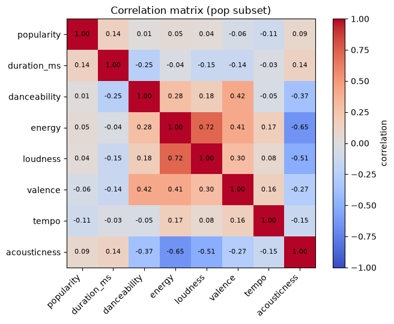

**Energy versus loudness** — The 1,000 pop tracks show a positive trend with substantial scatter.

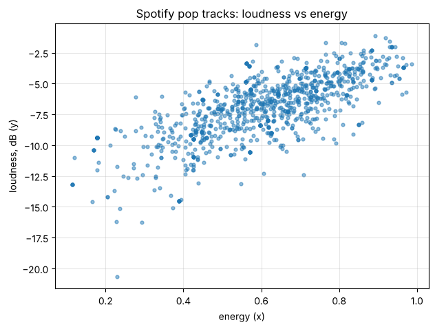

**OLS fit** — The fitted regression line summarizes the relationship while showing that energy alone does not precisely predict every track's loudness.

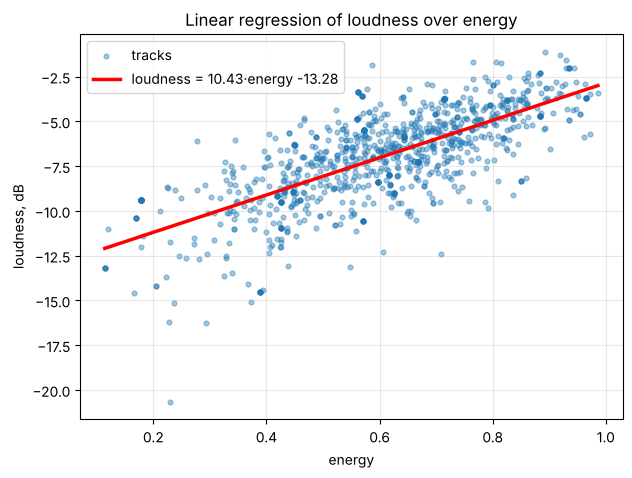

**Relative-error distributions** — Histograms compare data-analysis and machine-learning relative errors, which use different denominators.

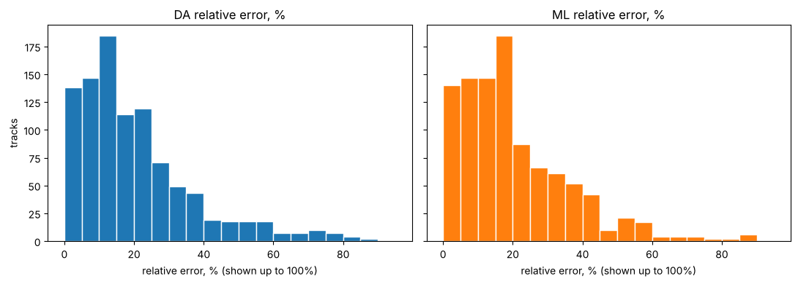

**Fit and residual diagnostics** — The combined view shows the fitted line and residuals versus energy; residual spread remains despite a broadly linear trend.


</details>

<details>
<summary><strong>A2 — PCA/SVD and hidden ranking factor</strong></summary>

**Principal-component projections** — The first two component scores compare range normalization with z-scoring; explicit tracks are highlighted.

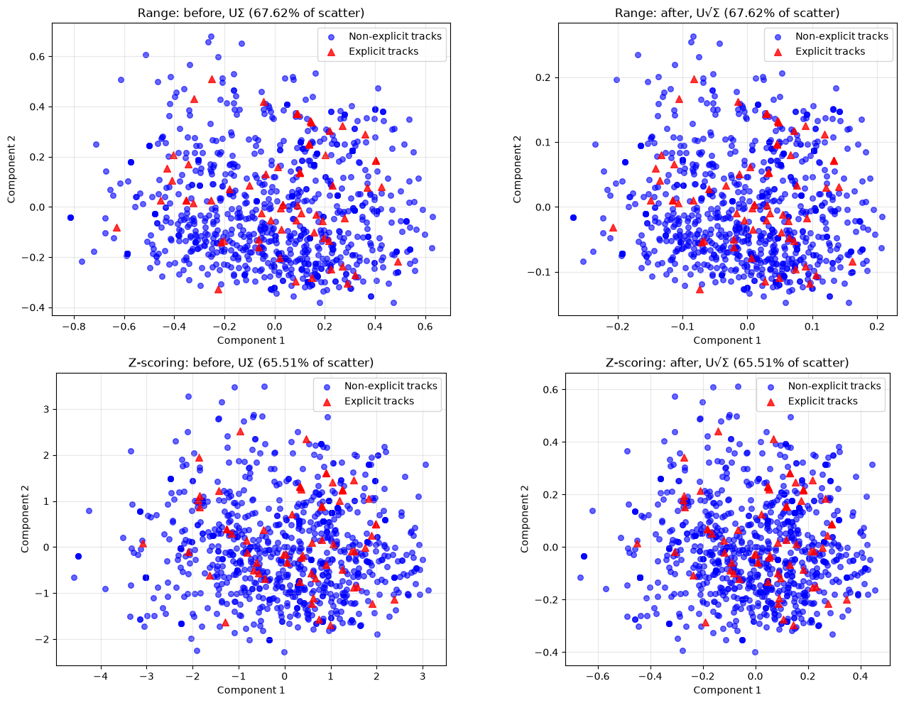

**Component loadings** — Feature weights show how the first two components can be interpreted, including the intensity and tempo contrasts.

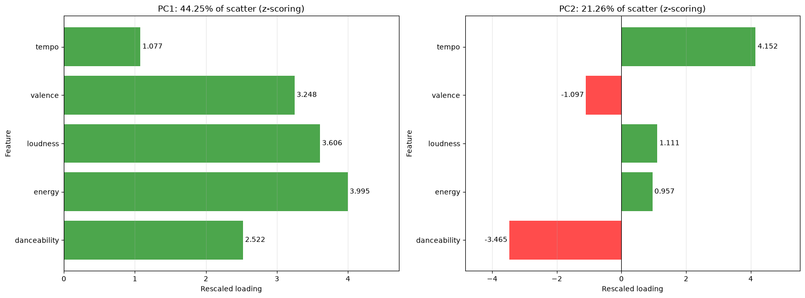

**Conventional PCA comparison** — Balanced factors from SVD are compared with the correlation-matrix eigen-decomposition; the two computations agree numerically.

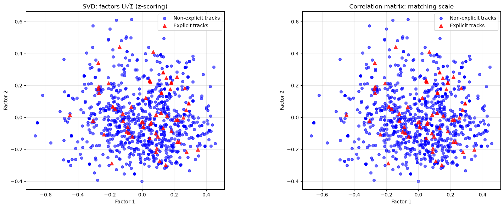

**Hidden ranking factor** — Score distributions compare explicit and non-explicit tracks on the 0–100 energetic/upbeat scale.

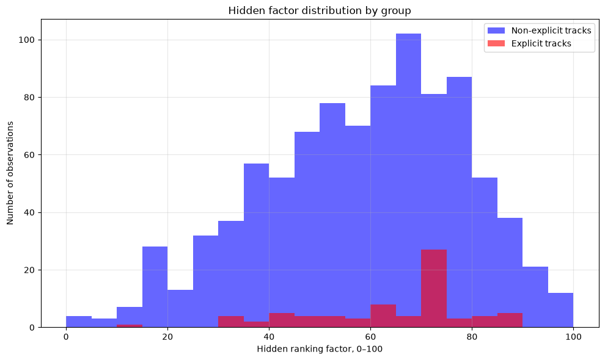

</details>

<details>
<summary><strong>A3 — K-means clustering</strong></summary>

**Initialization stability** — Objective values across 15 random starts for each of $K=4$ and $K=7$; lower values indicate a better within-cluster fit.

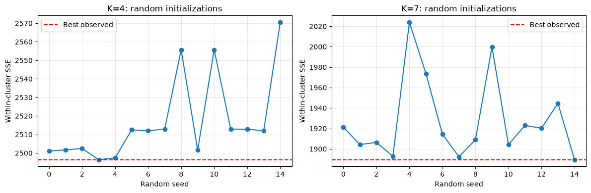

**Cluster profiles** — Relative deviations of cluster means from the overall feature means for both partitions. The profiles support naming the four-cluster solution and show how the seven-cluster solution subdivides it.

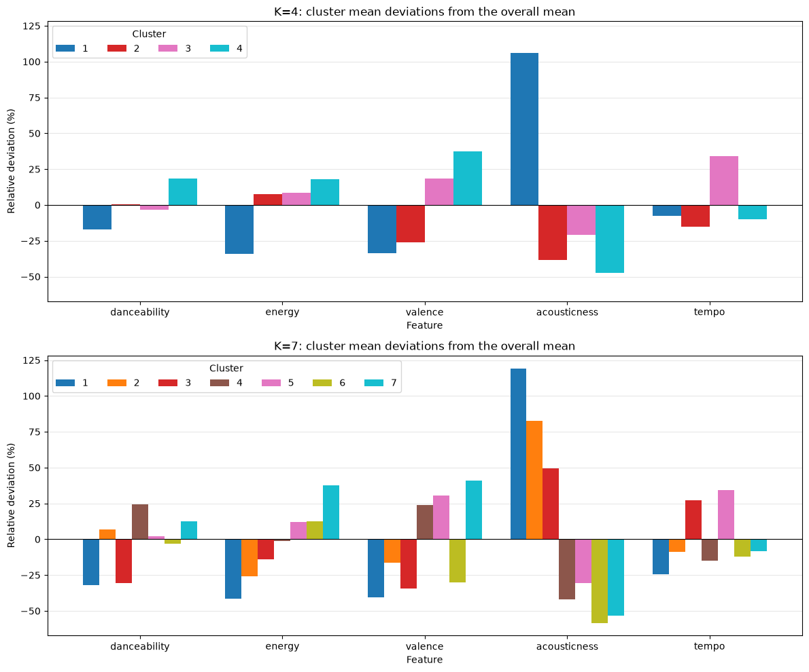

</details>

<details>
<summary><strong>A4 — Popularity and explicit status</strong></summary>

**Popularity distribution** — The pop sample has a large zero-score spike and a main concentration around popularity 70; these scores are grouped for the contingency analysis.

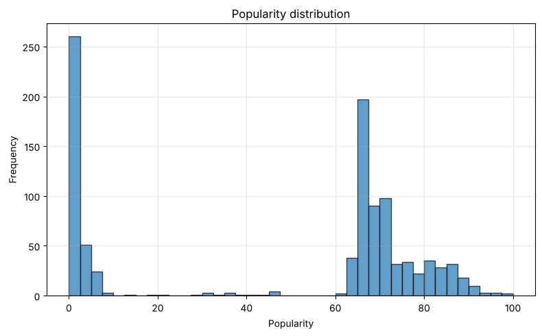

</details>

<details>
<summary><strong>A5 — Bootstrap confidence intervals</strong></summary>

Each plot shows a 10,000-resample bootstrap distribution and the 95% intervals.

**Mean energy** — Pivotal and percentile intervals for the grand mean.

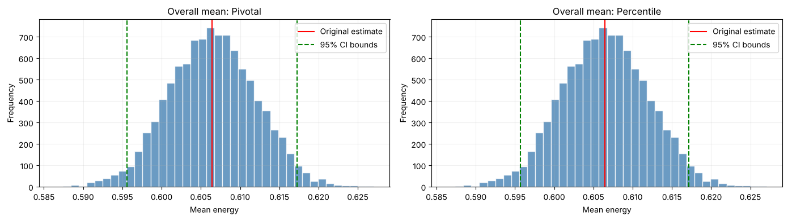

**Cluster 3 minus cluster 2** — Both intervals include zero, so the observed energy difference is not statistically distinguishable from zero at the 95% level.

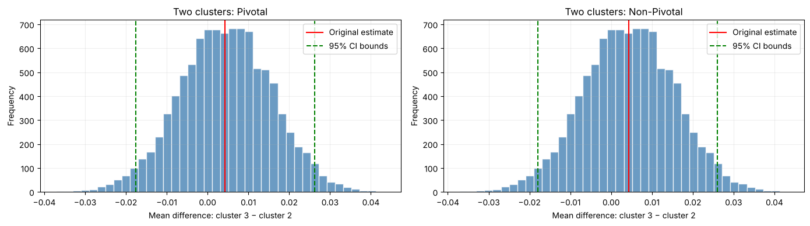

**Nearest cluster minus grand mean** — Both intervals are above zero, indicating that the nearest cluster's mean energy differs from the overall mean.

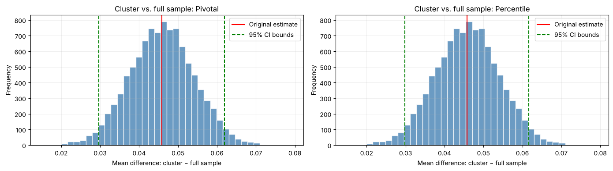

</details>

## Additional image files in the repository

These six images are also retained in `figures/` but are not included in the current A1–A5 report. The full-dataset exploratory images are legacy outputs; including them here does not add that analysis back to the paper.

**Alternate A1 scatter export** — A standalone export of energy versus loudness for the pop tracks, complementing the report's scatterplot.


**Full-dataset PCA projections (legacy)** — First-two-component scores under range normalization and z-scoring for the broader 89,741-track dataset; explicit tracks are highlighted.


**Full-dataset correlation heatmap (legacy)** — Pairwise correlations among numeric features in the cleaned dataset; strong energy–loudness and negative energy–acousticness relationships are visible.

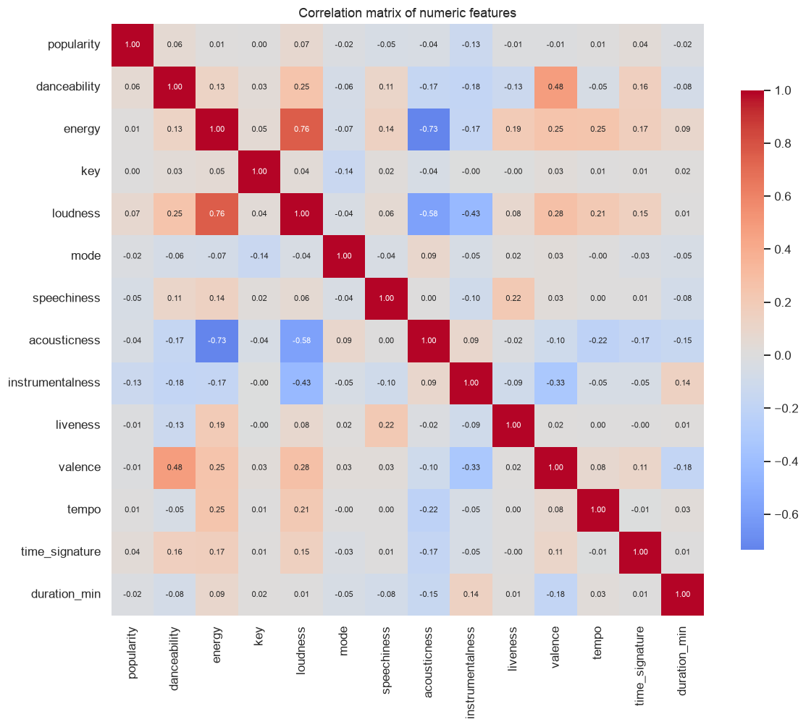

**Explicit-content classifier confusion matrix (legacy)** — Held-out predictions versus actual labels. It shows many more correctly classified non-explicit tracks than explicit tracks, reflecting the class imbalance.

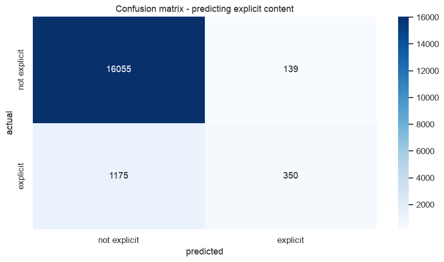

**Full-dataset K-means profiles (legacy)** — Average audio-feature values for two clusters from a separate full-dataset analysis; one profile is more energetic and the other more acoustic.

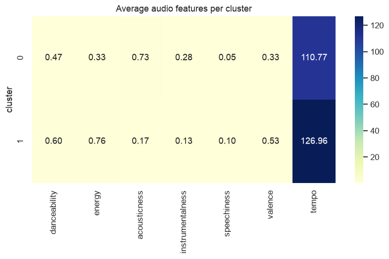

**Alternate A1 fit-and-residual export** — A second saved copy of the energy–loudness OLS fit and residual diagnostic shown in the report.

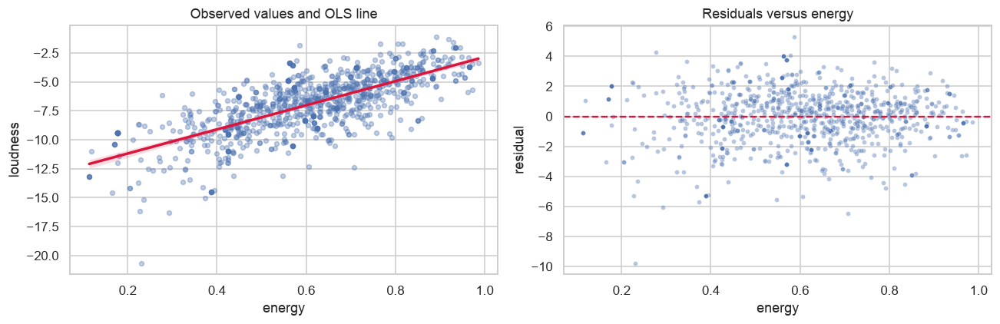

## Dataset

The source Spotify Tracks dataset contains 114,000 rows across 114 genres. The assignments use [`spotify_pop_1000.csv`](spotify_pop_1000.csv), a 1,000-row pop subset with eight quantitative features and the `explicit` group label.

To regenerate the subset, download the source CSV from [Kaggle](https://www.kaggle.com/datasets/maharshipandya/spotify-tracks-dataset), save it as `spotify_dataset.csv` in the repository root, and run the A1 notebook. A2–A5 use the prepared pop-subset CSV.

The `.gitignore` rules cover raw and generated full-dataset CSVs. Those files are already tracked in this checkout; ignore rules do not remove files already tracked by Git.

## Reproduce the analysis

### Run the notebooks

Use Python 3 and install the notebook dependencies:

```bash
python -m venv .venv
source .venv/bin/activate          # Windows: .venv\Scripts\activate
python -m pip install numpy pandas matplotlib seaborn scikit-learn scipy jupyter
jupyter notebook
```

Run the five assignment notebooks in order when reproducing the analysis from raw data. The report documents fixed seeds: 42 for sampling and bootstrap and 0–14 for K-means initializations.

### Build the report

Install a LaTeX distribution that includes `latexmk` and `pdflatex`, then build from the report directory so the relative figure and logo paths resolve:

```bash
cd report
latexmk -pdf -interaction=nonstopmode -halt-on-error main.tex
```

The compiled report is [`report/main.pdf`](report/main.pdf). LaTeX auxiliary files are ignored by Git; the PDF, source, notebooks, figures, logo assets, and pop-subset CSV are retained.

## Repository layout

```text
.
├── Assignment1_Correlation_Spotify.ipynb
├── Assignment2_PCA_SVD_Spotify.ipynb
├── Assignment3_KMeans_Spotify.ipynb
├── Assignment4_Contingency_Spotify.ipynb
├── Assignment5_Bootstrap_Spotify.ipynb
├── figures/                 # Report figures
├── logos/                   # HSE logo assets
├── report/
│   ├── main.tex             # LaTeX source
│   ├── main.pdf             # Compiled report
│   └── logos/               # Logo assets used by the report
├── spotify_pop_1000.csv     # Analysis sample
├── .gitignore
└── README.md
```

## References

- Spotify Tracks Dataset (114k songs), [Kaggle](https://www.kaggle.com/datasets/maharshipandya/spotify-tracks-dataset).
- Mirkin, B. (2026). *Basics of Data Analysis*, HSE University course materials and lecture notes.

**Author:** S. M. Gazzali Arafat Nishan · **Supervisor:** Prof. Boris Grigoryevich Mirkin
**Faculty:** Faculty of Computer Science, HSE University · **Moscow, 2026**
