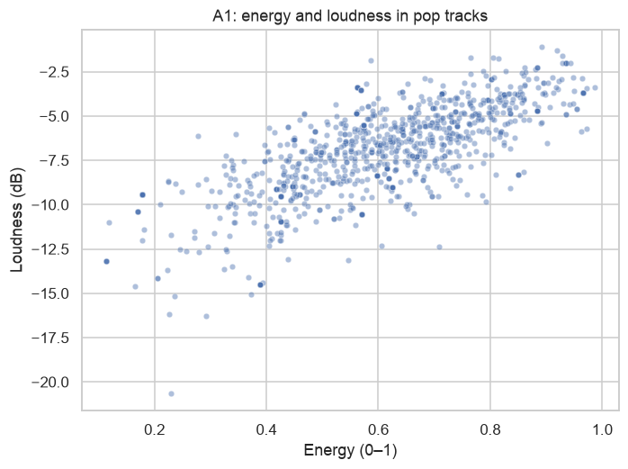
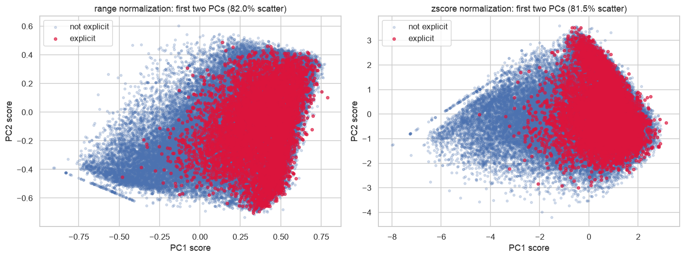

<div align="center">

# Spotify Tracks Analysis: Regression, Correlation, and PCA/SVD

### Least-Squares Approximation of Audio Features — A Reproducible Study in Basics of Data Analysis

**S M Gazzali Arafat Nishan**

*Faculty of Computer Science, National Research University Higher School of Economics (HSE), Moscow*

Supervisor: Prof. Boris Mirkin · Course: *Basics of Data Analysis* · 2026


</div>

---

## Abstract

We study the Spotify Tracks dataset (≈114,000 rows, 21 variables, 114 genres) through the *approximation (least-squares) perspective* of data analysis. **Part A1** fits a two-dimensional linear regression of `loudness` on `energy` within a single homogeneous genre (*pop*, $n = 1{,}000$) to avoid cross-genre confounding. The fitted line $\widehat{\text{loudness}} = -13.2765 + 10.4257\cdot\text{energy}$ attains $\rho = 0.7230$ and a determinacy coefficient $\rho^2 = 0.5228$; on a seeded 80/20 hold-out split the test $\rho^2$ is $0.5101$ with a mean relative absolute error of $\approx 23\%$, showing that the linear pattern generalises but that individual predictions stay imprecise (residual SD $\approx 1.77$ dB). **Part A2** applies PCA/SVD to four audio features (`energy`, `loudness`, `danceability`, `valence`) over $n = 89{,}741$ unique tracks under two preprocessing schemes — range normalization and z-scoring — and verifies that model-based SVD on z-scored data coincides with conventional correlation-matrix PCA. The first two components retain **81.99 %** and **81.54 %** of the data scatter respectively. Finally, a *hidden ranking factor* on a 0–100 scale is derived from the first singular vector of percentile-ranked features. A supplementary exploratory analysis (cleaning, random-forest classification of the `explicit` flag, and K-Means clustering) is included.

**Keywords:** simple linear regression · Pearson correlation · determinacy coefficient · mean relative absolute error · principal component analysis · singular value decomposition · data scatter · hidden ranking factor · Spotify audio features

---

## Table of Contents

1. [Introduction](#1-introduction)
2. [Background and Notation](#2-background-and-notation)
3. [Data](#3-data)
4. [Methodology](#4-methodology)
5. [Results](#5-results)
   - [5.1 A1 — Two-Dimensional Regression and Correlation](#51-a1--two-dimensional-regression-and-correlation)
   - [5.2 A2 — PCA/SVD, Visualization, and Hidden Ranking Factor](#52-a2--pcasvd-visualization-and-hidden-ranking-factor)
   - [5.3 Supplementary Exploratory Analysis](#53-supplementary-exploratory-analysis)
6. [Discussion](#6-discussion)
7. [Limitations and Threats to Validity](#7-limitations-and-threats-to-validity)
8. [Conclusion and Future Work](#8-conclusion-and-future-work)
9. [Reproducibility](#9-reproducibility)
10. [Repository Structure](#10-repository-structure)
11. [References](#11-references)
12. [Citation](#12-citation)
13. [Acknowledgements and License](#13-acknowledgements-and-license)

---

## 1. Introduction

Audio descriptors such as *energy*, *loudness*, *danceability*, and *valence* are widely used to characterise music, yet their mutual structure is rarely examined with elementary, fully transparent statistical tools. This project follows the data-analysis (DA) view of Lectures 2 and 3 of *Basics of Data Analysis* (Mirkin, 2026), in which regression and PCA are both treated as **least-squares approximation problems**: a data matrix is approximated by a low-complexity model, and the *share of data scatter explained* measures its quality.

The repository contains two homework assignments solved on the same dataset:

| ID | Topic | Core question |
|----|-------|---------------|
| **A1** | 2D linear regression & correlation | How well does `energy` linearly explain `loudness` within the pop genre, and how precise are the predictions? |
| **A2** | PCA / SVD & hidden ranking factor | How much of the joint variation of four audio features is captured by two components, how does preprocessing change the answer, and can a single 0–100 composite score be derived? |

**Contributions**

- A closed-form OLS analysis with explicit *DA vs. ML* relative-error definitions and a seeded train/test check (A1).
- A side-by-side comparison of **range-normalized** and **z-scored** model-based PCA via SVD, with a numerical proof of equivalence to conventional correlation-matrix PCA (A2).
- A loading-weighted **hidden ranking factor** with an explicit calibration anchor (A2).
- A documented data-cleaning pipeline and two supplementary machine-learning baselines.
- A fully reproducible notebook and a compiled-from-source LaTeX report.

---

## 2. Background and Notation

### 2.1 Ordinary least squares (A1)

For paired observations $(x_i, y_i)_{i=1}^n$ the model is $\hat y_i = \beta_0 + \beta_1 x_i$, with

$$
\beta_1 = \frac{S_{xy}}{S_{xx}}, \quad
S_{xx} = \sum_i (x_i - \bar x)^2, \quad
S_{xy} = \sum_i (x_i - \bar x)(y_i - \bar y), \quad
\beta_0 = \bar y - \beta_1 \bar x .
$$

The Pearson correlation is $\rho = \mathrm{Cov}(X,Y)/(s_X s_Y)$ and the **determinacy coefficient** is

$$
\rho^2 = 1 - \frac{SS_{\mathrm{res}}}{SS_{\mathrm{tot}}} ,
$$

the fraction of the variance of $Y$ accounted for by the linear relationship with $X$.

### 2.2 Relative-error conventions (A1)

Lecture 2 distinguishes two definitions of the mean relative absolute error (MRAE):

$$
\Delta_{\mathrm{DA}}(i) = \frac{|y_i - \hat y_i|}{|y_i|}, \qquad
\Delta_{\mathrm{ML}}(i) = \frac{|y_i - \hat y_i|}{|\hat y_i|}.
$$

They differ only in the denominator (observed vs. predicted value); both are reported.

### 2.3 PCA as low-rank approximation via SVD (A2)

For a preprocessed data matrix $X$ the SVD is $X = U \Sigma V^{\top}$. The **total data scatter** is $\|X\|_F^2 = \sum_k \sigma_k^2$, and component $k$ *contributes* $\sigma_k^2$, i.e. $100\,\sigma_k^2 / \|X\|_F^2$ percent. Columns of $V$ are **loadings**; the PC scores are $U_{[:,1:2]}\Sigma_{[1:2,1:2]}$. The sign of an entire component is arbitrary, so interpretation relies on *relative* signs and magnitudes.

**Preprocessing schemes compared**

$$
\text{Range-centered: } x'_{iv} = \frac{x_{iv} - \min_i x_{iv}}{\max_i x_{iv} - \min_i x_{iv}} - \tfrac12, \qquad
\text{Z-score: } z_{iv} = \frac{x_{iv} - \bar x_v}{s_v}.
$$

**Conventional PCA.** From the z-scored matrix $Y$, form $B = Y^{\top}Y/(n-1)$ (the correlation matrix) and diagonalise it; eigenvectors are loadings and $Yc_k$ are scores.

---

## 3. Data

| Property | Value |
|----------|-------|
| Source | [Kaggle — Spotify Tracks Dataset (114k songs)](https://www.kaggle.com/datasets/maharshipandya/spotify-tracks-dataset) |
| Raw size | 114,000 rows × 21 columns |
| Genres | 114 |
| Key features used | `energy`, `loudness`, `danceability`, `valence` (+ `explicit`, `track_genre`) |

> **The raw CSV is not redistributed in this repository.** Download it from Kaggle and place it as `spotify_dataset.csv` next to the notebook.

### 3.1 Analysis subsets

| Part | Subset | $n$ | Rationale |
|------|--------|-----|-----------|
| A1 | `track_genre == "pop"`, complete cases for `energy` and `loudness` | 1,000 | A single homogeneous genre avoids Simpson-type confounding across genres (supervisor's advice). |
| A2 | One row per `track_id`, complete cases for the four features and `explicit` | 89,741 | Prevents tracks listed under several genres from weighting the PCA repeatedly. |
| EDA / ML | Cleaned track table (Section 3.2) | 88,595 | Track-level supplementary modelling. |

### 3.2 Cleaning pipeline (supplementary analysis)

| Step | Rows remaining |
|------|---------------:|
| Raw file | 114,000 |
| Drop exported index column; drop the single row with missing `artists` / `album_name` / `track_name` | 113,999 |
| Keep one row per `track_id` (24,259 repeated IDs) | 89,740 |
| Remove tracks longer than 15 min (141 tracks; DJ mixes, white noise) | 89,599 |
| Remove impossible `time_signature` values (0 and 1; 1,004 rows) | **88,595** |

`key` and `mode` are additionally decoded into readable labels, and `explicit` is cast to boolean.

---

## 4. Methodology

### 4.1 A1 — Regression protocol

1. Select the pair **predictor** $X$ = `energy` ∈ [0, 1], **target** $Y$ = `loudness` (dB) and inspect the scatter plot for approximate linearity.
2. Estimate $\beta_0, \beta_1$ in closed form (verified identical to `sklearn.linear_model.LinearRegression`).
3. Compute $\rho$, $\rho^2$, the sum-of-squares decomposition, and the residual SD.
4. Predict `loudness` at `energy` ∈ {0.2, 0.4, 0.6, 0.8}.
5. Report MAE, RMSE, and MRAE under both the DA and ML definitions on the **full sample**.
6. Re-fit on a seeded random **80/20 split** (`random_state = 42`; 800 train / 200 test) and report held-out MAE, MRAE, and $\rho^2$.
7. Inspect residuals versus `energy` for systematic curvature.

### 4.2 A2 — PCA/SVD protocol

1. Select four related features: `energy`, `loudness`, `danceability`, `valence`. Loudness is in dB while the others lie on [0, 1], so preprocessing materially affects the result.
2. Pre-specify the highlighted group: **explicit tracks** (7,704 of 89,741).
3. Apply **range normalization** and **z-scoring** separately.
4. For each, compute the SVD, total scatter, per-component contributions, loadings, and the first-two-component scores.
5. Plot PC1 vs. PC2 with the explicit group highlighted.
6. Verify equivalence with conventional correlation-matrix PCA (eigen-decomposition of $B$).
7. **Hidden ranking factor:** convert each feature to a percentile rank on [0, 100]; take the first right singular vector of the rank matrix; orient it to a positive sum; normalise the weights to sum to one; compute the weighted rank score; rescale so that the **maximum observed score equals 100** (the calibration anchor).

### 4.3 Supplementary models

- **Classification:** `StandardScaler` + `RandomForestClassifier` (200 trees) predicting `explicit` from ten audio features; stratified 80/20 split.
- **Clustering:** K-Means on seven standardised features; $k \in \{2,\dots,6\}$ selected by silhouette score (10,000-point sample).

---

## 5. Results

### 5.1 A1 — Two-Dimensional Regression and Correlation

<p align="center">
  
</p>
<p align="center"><em>Figure 1a. Scatter plot of energy vs. loudness for pop tracks (n = 1,000).</em></p>

<p align="center">
  
</p>
<p align="center"><em>Figure 1b. Fitted OLS line (left) and residuals vs. energy (right).</em></p>

**Fitted model**

$$
\widehat{\text{loudness}} = -13.2765 + 10.4257 \times \text{energy}
$$

A rise of 0.1 in energy corresponds to ≈ **+1.043 dB** of loudness — an *association*, not a causal claim.

**Summary statistics**

| Quantity | Value |
|----------|------:|
| $\bar x$ (energy) / $\bar y$ (loudness) | 0.606437 / −6.953969 |
| $S_{xx}$ / $S_{xy}$ | 31.553180 / 328.963185 |
| Slope $\beta_1$ / intercept $\beta_0$ | 10.425675 / −13.276484 |
| Pearson $\rho$ | **0.7230** |
| Determinacy $\rho^2$ | **0.5228** (52.28 %) |
| $SS_{\mathrm{tot}}$ / $SS_{\mathrm{res}}$ / $SS_{\mathrm{reg}}$ | 6560.441 / 3130.777 / 3429.663 |
| Residual SD (RMSE) | 1.769 dB |

**Predictions**

| Energy $x$ | Predicted loudness (dB) |
|-----------:|------------------------:|
| 0.2 | −11.191 |
| 0.4 | −9.106 |
| 0.6 | −7.021 |
| 0.8 | −4.936 |

**Error comparison (DA vs. ML views)**

| Metric | Full sample | Train (n=800) | Test (n=200) |
|--------|------------:|--------------:|-------------:|
| $\rho^2$ | 0.5228 | 0.5259 | 0.5101 |
| MAE (dB) | 1.376 | — | 1.438 |
| RMSE (dB) | 1.769 | — | — |
| MRAE$_{\mathrm{DA}}$ (÷ \|y\|) | 23.13 % | — | 23.53 % |
| MRAE$_{\mathrm{ML}}$ (÷ \|ŷ\|) | 20.44 % | — | 21.34 % |
| Coefficients $(\beta_0, \beta_1)$ | (−13.2765, 10.4257) | (−13.3293, 10.5213) | — |

**Residual diagnostics.** Residuals are centred on zero with no strong curvature, supporting the linear specification. Some residuals exceed ±5 dB, and a few low-energy tracks have large negative residuals worth inspecting before any high-stakes use.

---

### 5.2 A2 — PCA/SVD, Visualization, and Hidden Ranking Factor

#### 5.2.1 Component contributions

| Normalization | Total scatter | $\sigma_1$ | PC1 | $\sigma_2$ | PC2 | PC1 + PC2 |
|---------------|--------------:|-----------:|----:|-----------:|----:|----------:|
| Range-centered | 24,057.89 | 113.84 | 53.87 % | 82.26 | 28.13 % | **81.99 %** |
| Z-score | 358,960.00 | 436.91 | 53.18 % | 319.08 | 28.36 % | **81.54 %** |

Full contributions (percent of scatter):

| Normalization | PC1 | PC2 | PC3 | PC4 |
|---------------|----:|----:|----:|----:|
| Range-centered | 53.87 | 28.13 | 12.26 | 5.75 |
| Z-score | 53.18 | 28.36 | 12.76 | 5.69 |

#### 5.2.2 Loadings

| Feature | Range PC1 | Range PC2 | Z-score PC1 | Z-score PC2 |
|---------|----------:|----------:|------------:|------------:|
| `energy` | **0.687** | −0.116 | 0.545 | 0.479 |
| `loudness` | **0.637** | −0.295 | 0.580 | 0.373 |
| `danceability` | 0.282 | 0.279 | 0.406 | −0.608 |
| `valence` | 0.209 | **0.906** | 0.450 | −0.512 |

*Interpretation.* Under range normalization PC1 is an **intensity** axis (energy + loudness) and PC2 is essentially **valence**. Under z-scoring PC1 is a general "all-features-positive" axis, and PC2 **contrasts** danceability/valence against loudness/energy. Signs are only meaningful relatively.

#### 5.2.3 Visualization of the first two components

<p align="center">
  
</p>
<p align="center"><em>Figure 2. First two PC scores under range normalization (left) and z-scoring (right); explicit tracks highlighted in red.</em></p>

| Mean PC score | Normalization | Explicit | Other |
|---------------|---------------|---------:|------:|
| PC1 | Range | 0.370 | 0.262 |
| PC1 | Z-score | 0.539 | −0.051 |
| PC2 | Range | −0.100 | −0.098 |
| PC2 | Z-score | 0.058 | −0.005 |

Explicit tracks sit slightly higher on PC1 but show essentially no separation on PC2. These are **descriptive positions, not causal evidence**.

#### 5.2.4 Conventional PCA comparison

Diagonalising the correlation matrix $B$ yields eigenvalues `[2.127, 1.134, 0.511, 0.228]`, i.e. variance shares **53.18 %, 28.36 %, 12.76 %, 5.69 %** — identical to the z-score SVD contributions. The absolute loading agreement matrix between eigenvectors and SVD right-singular vectors is the identity, confirming equivalence up to sign and score scaling.

> **Which normalization?** Because the features have different units, z-scoring is the more balanced choice (unit variance per feature; exactly the input of conventional PCA). Range normalization instead weights features by their observed span. Neither is universally best — the choice states what differences should count.

#### 5.2.5 Hidden ranking factor (0–100)

| Feature | Weight |
|---------|-------:|
| `energy` | 0.252 |
| `loudness` | 0.254 |
| `danceability` | 0.245 |
| `valence` | 0.250 |

| Statistic | Score |
|-----------|------:|
| Median | 53.74 |
| Interquartile range | 37.97 – 66.66 |
| Mean (all) | 51.42 |
| Mean — explicit tracks | 59.12 |
| Mean — other tracks | 50.69 |

The near-uniform weights show that the four rank variables load almost equally on the leading factor. The score is a **sample-relative summary** of four features, anchored so that the maximum observed composite equals 100 — it is *not* a measure of musical quality.

---

### 5.3 Supplementary Exploratory Analysis

<p align="center">
  
</p>
<p align="center"><em>Figure 3. Pearson correlation matrix of numeric features (cleaned track table).</em></p>

**Key EDA findings**

- `popularity` is nearly symmetric (mean 33.25, median 33.0, skewness 0.07) but **10.5 %** of tracks sit at exactly 0.
- All correlations with `popularity` are weak: `instrumentalness` (−0.13), `loudness` (+0.07), `danceability` (+0.06).
- Explicit tracks are a minority (7,625 / 88,595) with slightly higher mean popularity (37.0 vs. 32.9).
- Mean popularity varies widely by genre: *k-pop* (59.6), *pop-film* (59.2), *metal* (56.5), *chill* (53.8) vs. *romance* (3.5) and *iranian* (2.3).
- IQR flagging marks many valid tracks in skewed features (e.g. `instrumentalness`, 21.9 %), so it is a warning list, not a delete list.

**ML 1 — Predicting the `explicit` flag (Random Forest)**

| Metric | Value |
|--------|------:|
| Accuracy | 0.9258 |
| Majority-class baseline | 0.9139 |
| Explicit — precision / recall / F1 | 0.72 / 0.23 / 0.35 |
| Not explicit — precision / recall / F1 | 0.93 / 0.99 / 0.96 |

Accuracy barely beats the baseline; recall on the minority class is low. `speechiness` dominates feature importance (0.178 vs. 0.103 for `danceability`).

<p align="center">
  
</p>
<p align="center"><em>Figure 4. Confusion matrix of the explicit-content classifier.</em></p>

**ML 2 — K-Means clustering**

| $k$ | 2 | 3 | 4 | 5 | 6 |
|-----|---:|---:|---:|---:|---:|
| Silhouette | **0.245** | 0.196 | 0.206 | 0.208 | 0.222 |

The selected $k = 2$ yields a quieter **acoustic** cluster (24,864 tracks; acousticness 0.74, energy 0.33) and a louder, more **danceable** cluster (63,731 tracks; energy 0.76, acousticness 0.17).

<p align="center">
  
</p>
<p align="center"><em>Figure 5. Average audio features per cluster.</em></p>

---

## 6. Discussion

1. **A respectable $\rho^2$ does not imply precise predictions.** With $\rho^2 \approx 0.52$ the residual SD remains ≈ 1.8 dB, so individual tracks of equal energy can differ by ±2–3 dB. The model describes a *tendency*, not an exact rule.
2. **The linear pattern is stable.** Test $\rho^2$ (0.510) is only 0.016 below training $\rho^2$ (0.526), and test MRAE is within ≈ 1 percentage point of the full-sample value — no serious over-fitting.
3. **DA and ML relative errors differ by construction.** The only change is the denominator ($|y|$ vs. $|\hat y|$); both remain in the 20–24 % band.
4. **Single-genre analysis removes confounding.** Restricting A1 to *pop* avoids the Simpson-paradox situation illustrated in the lecture.
5. **Preprocessing is a modelling decision.** The PCs under range normalization and z-scoring share a similar scatter profile (≈ 82 % in two components) but different loadings, because the two schemes define "importance" differently.
6. **Two components suffice for a faithful 2D picture** of the four audio features, but the explicit group is only weakly separated, so these features alone are not strongly characteristic of explicit content.

---

## 7. Limitations and Threats to Validity

- **Small A1 sample.** $n = 1{,}000$ pop tracks; the subset is built from the raw file and contains **7 repeated `track_id`s**, which were retained.
- **Single predictor.** Energy alone leaves ≈ 48 % of loudness variance unexplained; compression, mastering, and instrumentation are not modelled.
- **Association only.** No causal interpretation of any slope, loading, or group difference is claimed.
- **Dataset sampling.** Genre-level statistics reflect the tracks sampled per genre, not worldwide listening (e.g. *metal* outranks *pop* in mean popularity).
- **PCA is preprocessing-dependent** and linear; non-linear structure is not captured.
- **Hidden factor is relative.** The 0–100 scale is anchored to the sample maximum and is not a validated quality metric.
- **Sign indeterminacy.** Singular-vector signs may flip across software runs without changing the solution.
- **Supplementary ML** uses a single split and default-style hyper-parameters; no cross-validation or class re-weighting.

---

## 8. Conclusion and Future Work

A linear model of `loudness` on `energy` explains 52.3 % of loudness variance within the pop genre ($\rho = 0.723$) with moderate errors (MAE ≈ 1.4 dB, MRAE ≈ 23 %) and a negligible train/test gap. PCA/SVD on four audio features compresses 82 % of the scatter into two interpretable components, matches conventional PCA exactly under z-scoring, and yields a transparent 0–100 hidden ranking factor.

**Future work**

1. Extend A1 to multiple regression (add `acousticness`, `danceability`, …) and compare with gradient boosting.
2. Use the full multi-genre list per track instead of a single label (multi-label analysis).
3. Tune the explicit-content classifier (class weights, cross-validation, boosting).
4. Add text features (TF-IDF on `track_name`, `album_name`) alongside audio features.
5. Bootstrap confidence intervals for $\beta_1$, $\rho^2$, and PCA loadings.

---

## 9. Reproducibility

**Environment** (versions recorded in the notebook)

| Package | Version |
|---------|---------|
| Python | 3.14.7 |
| pandas | 3.0.6 |
| NumPy | 2.5.3 |
| seaborn | 0.13.2 |
| matplotlib, scikit-learn, SciPy | recent stable releases |

**Run the notebook**

```bash
git clone https://github.com/<your-username>/<your-repo>.git
cd <your-repo>

python -m venv .venv
source .venv/bin/activate            # Windows: .venv\Scripts\activate
pip install numpy pandas matplotlib seaborn scikit-learn scipy jupyter

# place the Kaggle CSV here as spotify_dataset.csv
jupyter notebook bda.ipynb
```

**Build the report**

```bash
pdflatex bda_report-2026.tex
pdflatex bda_report-2026.tex      # run twice to resolve the table of contents
```

The report expects `pop_energy_loudness_analysis.png` (the A1 figure) in the same folder.

**Determinism notes**

- Train/test split: 20 % held out, `random_state = 42`.
- OLS is computed analytically and matches `sklearn.linear_model.LinearRegression`.
- K-Means uses `random_state = 42`, `n_init = 10`; silhouette is computed on a 10,000-point sample (seeded).
- All A2 values use `numpy.linalg.svd` on the exact transformations in Section 2.3.

---

## 10. Repository Structure

```
.
├── bda.ipynb                     # Executable notebook: EDA, A1, A2, supplementary ML
├── bda_report-2026.tex           # LaTeX source of the formal report (A1 + A2)
├── pop_energy_loudness_analysis.png   # A1 figure used by the report
├── figures/                      # Figures exported from the notebook (used in this README)
├── spotify_dataset.csv           # NOT included — download from Kaggle
├── spotify_clean.csv             # Generated by the notebook (cleaned track table)
└── README.md
```

**Notebook map**

| Section | Content |
|---------|---------|
| 1–4 | Setup, loading, types and summary statistics, cleaning |
| 5–7 | Univariate analysis, bivariate analysis, IQR outlier detection |
| 8–9 | Random-forest classifier (`explicit`), K-Means clustering |
| 10 | Findings and next steps |
| **A1.1–A1.3** | Feature pair, OLS/correlation/determinacy, predictions and MRAE |
| **A2.1–A2.5** | Feature/group choice, SVD under two normalizations, 2D visualization, conventional PCA, hidden ranking factor |

---

## 11. References

1. Galton, F. (1886). Regression towards mediocrity in hereditary stature. *Journal of the Anthropological Institute*, 15, 246–263.
2. Pearson, K. (1895). Notes on regression and inheritance in the case of two parents. *Proceedings of the Royal Society of London*, 58, 240–242.
3. Mirkin, B. (2026). *Basics of Data Analysis. Lecture 2: 2D Regression and Correlation Coefficient.* HSE University, lecture notes.
4. Mirkin, B. (2026). *Basics of Data Analysis. Lecture 3: Principal Component Analysis and SVD.* HSE University, lecture notes.
5. Kaggle (2020–2024). *Spotify Tracks Dataset (114k songs).* <https://www.kaggle.com/datasets/maharshipandya/spotify-tracks-dataset>

---

## 12. Citation

If you use this work, please cite:

```bibtex
@misc{nishan2026spotifybda,
  author       = {Nishan, S M Gazzali Arafat},
  title        = {Spotify Tracks Analysis: Regression, Correlation, and PCA/SVD},
  year         = {2026},
  institution  = {National Research University Higher School of Economics},
  note         = {Course project, Basics of Data Analysis. Supervisor: Boris Mirkin},
  howpublished = {\url{https://github.com/<your-username>/<your-repo>}}
}
```

---

## 13. Acknowledgements and License

I thank **Prof. Boris Mirkin** for the course framework, the choice of a homogeneous genre, and the approximation-based view of regression and PCA. The dataset is provided via Kaggle; please respect its original license and terms.

Code and report are released under the **MIT License** (see `LICENSE`).

<div align="center">

*Moscow, 2026*

</div>
